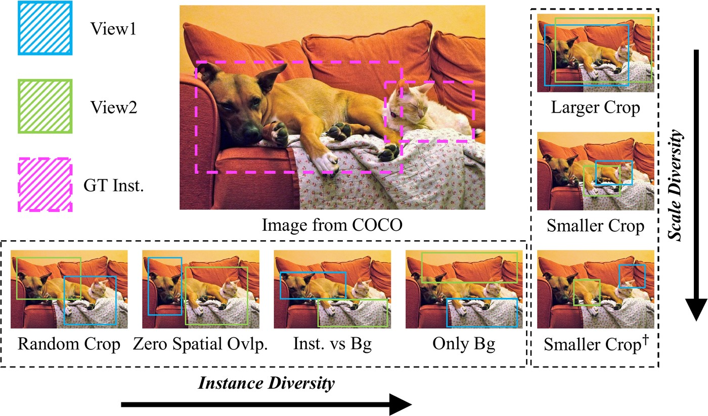
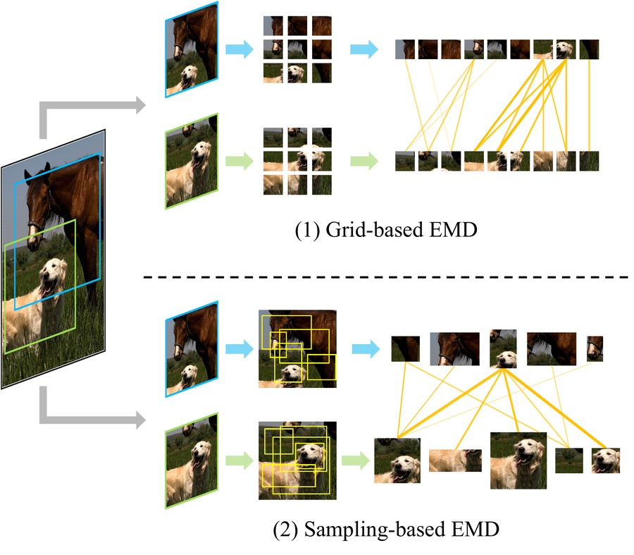

<div align="center">

# Beyond Instance Consistency: Investigating View Diversity in Self-supervised Learning

### TMLR 2025

Huaiyuan Qin<sup>1</sup>&nbsp;&nbsp; Muli Yang<sup>1</sup>&nbsp;&nbsp; Siyuan Hu<sup>2</sup>&nbsp;&nbsp; Peng Hu<sup>3</sup>&nbsp;&nbsp; Yu Zhang<sup>4</sup>&nbsp;&nbsp; Chen Gong<sup>5</sup>&nbsp;&nbsp; Hongyuan Zhu<sup>1</sup>

<sup>1</sup>Institute for Infocomm Research (I<sup>2</sup>R), A*STAR&nbsp;&nbsp;&nbsp;
<sup>2</sup>National University of Singapore&nbsp;&nbsp;&nbsp;
<sup>3</sup>Sichuan University&nbsp;&nbsp;&nbsp;
<sup>4</sup>Southeast University&nbsp;&nbsp;&nbsp;
<sup>5</sup>Shanghai Jiao Tong University

[](https://arxiv.org/abs/2509.11344)
[](https://arxiv.org/pdf/2509.11344)
[](https://openreview.net/forum?id=urWCU3YMA0)
[](LICENSE)



**Positive pairs do not need to share an object instance, and a moderate view diversity works best.**

</div>

Self-supervised learning (SSL) treats two views of the same image as a positive pair and assumes
that they show the same instance. This instance consistency breaks down on non-iconic data such as
COCO, where two crops of an image can show different objects. We pre-train MoCo v2 and DINO on COCO
and ImageNet-100 with positive pairs of controlled instance consistency and view diversity (figure
above) and find that

* SSL still learns meaningful representations when the two views share no instance, as long as they
  come from the same image: *Zero Spatial Overlap*, *Inst. vs Bg* and *Only Bg* all outperform the
  random-crop baseline;
* more view diversity (zero overlap or smaller crops) improves classification and dense prediction,
  but too much diversity (smaller crops with zero overlap) does not help anymore;
* the Earth Mover's Distance (EMD) between the local features of the two views estimates the
  information they share, and a moderate EMD-based similarity goes with the best downstream results.

This repository is a cleaned-up re-implementation of the code of the paper. It contains

* [`views.py`](views.py): the view configurations, i.e. paired crops sampled under spatial
  constraints given the boxes of the object instances,
* [`emd.py`](emd.py) and `main_emd.py`: the EMD-based similarity of the views of a configuration,
* `main_moco.py` (MoCo v2) and `main_dino.py` (DINO): pre-training with any view configuration,
* `main_linear.py`: linear evaluation, and `tools/extract_backbone.py` to export the backbone for
  detection and other downstream tasks.

## Installation

```bash
conda env create -f environment.yml
conda activate view-diversity
```

The code needs PyTorch >= 2.1, torchvision and OpenCV (exact EMD solver). The DeiT encoders of
`main_emd.py` additionally need `timm`.

## Data

Pre-training uses COCO train2017 (non-iconic) and ImageNet-100 (iconic, the 100 ImageNet-1K
classes listed in [`util/imagenet100.txt`](util/imagenet100.txt)):

```
/path/to/coco/train2017/*.jpg
/path/to/coco/annotations/instances_train2017.json
/path/to/imagenet/train/<class>/*.JPEG
```

The configurations that depend on object instances read the instance boxes from a COCO-format json
(`--ann_file`): the ground-truth boxes of `instances_train2017.json` for COCO, and pseudo boxes of
[MaskCut](https://github.com/facebookresearch/CutLER/tree/main/maskcut) (at most 3 per image) for
ImageNet-100. To compute the MaskCut boxes, link the 100 classes into one folder and run MaskCut
from the CutLER repository:

```bash
mkdir -p /path/to/imagenet100/train
while read c; do ln -s /path/to/imagenet/train/$c /path/to/imagenet100/train/$c; done < util/imagenet100.txt

cd CutLER/maskcut
python maskcut.py --vit-arch base --patch-size 8 --tau 0.15 --fixed_size 512 --N 3 \
    --num-folder-per-job 100 --job-index 0 \
    --dataset-path /path/to/imagenet100/train --out-dir /path/to/maskcut
```

The file names in the json are relative to the class folders, so `--data_path` can be either
`/path/to/imagenet/train` or `/path/to/imagenet100/train`. Without `--ann_file`, all images under
`--data_path` are used (`--class_list util/imagenet100.txt` keeps the ImageNet-100 classes only),
which is enough for the configurations that need no boxes.

The datasets of the linear evaluation (CIFAR-10/100, STL-10, DTD, Oxford-IIIT Pets) are downloaded
by torchvision.

## View configurations

| Configuration (paper) | `--views` | `--crop_scale` COCO | `--crop_scale` ImageNet-100 |
|---|---|---|---|
| Baseline (random crops) | `random` | `0.2 1.0` | `0.2 1.0` |
| Lower Bound | `lower_bound` | `0.2 1.0` | `0.2 1.0` |
| Zero Spatial Overlap | `zero_overlap` | `0.2 1.0` | `0.2 1.0` |
| Inst. vs Bg | `instance_vs_bg` | `0.2 1.0` | `0.2 1.0` |
| Only Bg | `only_bg` | `0.2 1.0` | `0.2 1.0` |
| Larger Crop | `random` | `0.4 1.0` | `0.4 1.0` |
| Smaller Crop | `random` | `0.08 0.4` | `0.18 0.9` |
| Smaller Crop + Zero Spatial Overlap | `zero_overlap` | `0.08 0.4` | `0.18 0.9` |

For DINO, the crop scale is the one of the two global crops (`--global_crops_scale`).

* `zero_overlap`: IoU(v<sub>1</sub>, v<sub>2</sub>) = 0.
* `instance_vs_bg`: IoU(v<sub>1</sub>, v<sub>2</sub>) = 0, v<sub>1</sub> covers an object instance
  (IoU > `--inst_iou` = 0.8 with its box) and v<sub>2</sub> covers background only (IoU < `--bg_iou` = 0.1
  with every instance box).
* `only_bg`: IoU(v<sub>1</sub>, v<sub>2</sub>) = 0 and both views cover background only
  (IoU < `--bg_iou` = 0.1 with every instance box).
* `lower_bound`: the two views of a positive pair come from two different images.

The crops are RandomResizedCrop boxes drawn by rejection sampling. The instance view is taken around
one of the 10 largest instances of the image (`--max_boxes`); when no crop of the given scale reaches
the IoU (small instances), the instance box itself, slightly enlarged, is used. The order of the two
views is random. If no pair satisfies the constraints, an unconstrained pair is used instead, and the
fraction of valid pairs is logged as `valid_pairs`.

`views.PairedCrop` does not depend on the training code and can be plugged into other SSL methods:

```python
from views import PairedCrop

paired_crop = PairedCrop('instance_vs_bg', size=224, scale=(0.2, 1.0))
crop1, crop2, valid = paired_crop(image, boxes)  # PIL image, boxes as a list of (x, y, w, h)
```

## Pre-training

All commands use a single machine with 8 GPUs and a total batch size of 256 for 100 epochs.

**MoCo v2** (`scripts/pretrain_moco.sh`): ResNet-50, SGD with a learning rate of 0.03 and a cosine
schedule.

```bash
torchrun --nproc_per_node=8 main_moco.py \
    --data_path /path/to/coco/train2017 \
    --ann_file /path/to/coco/annotations/instances_train2017.json \
    --views zero_overlap --crop_scale 0.2 1.0 \
    --epochs 100 --batch_size 256 --lr 0.03 \
    --output_dir ./output_dir/moco_coco_zero_overlap
```

**DINO** (`scripts/pretrain_dino.sh`): ViT-S/16, AdamW with a learning rate of 5e-4, and the other
hyper-parameters of DINO. The view configuration is applied to the two global crops (scale
`0.2 1.0` by default); the 8 local crops are sampled as in DINO.

```bash
torchrun --nproc_per_node=8 main_dino.py \
    --arch vit_small --patch_size 16 \
    --data_path /path/to/imagenet/train \
    --ann_file /path/to/imagenet100_maskcut.json \
    --views instance_vs_bg --global_crops_scale 0.2 1.0 \
    --epochs 100 --batch_size_per_gpu 32 --lr 0.0005 \
    --output_dir ./output_dir/dino_in100_instance_vs_bg
```

Both scripts resume automatically from `output_dir/checkpoint.pth`.

## EMD-based view similarity

<div align="center">

</div>

`main_emd.py` (`scripts/emd.sh`) generates the positive pairs of a view configuration exactly as for
pre-training and averages their EMD-based similarity (Sec. 4.3 and Appendix A.3). Each view is split
into patches, either *grid-based* (2x2 and 3x3 grids of enlarged cells) or *sampling-based* (9 random
crops), and every patch is encoded by a frozen pre-trained encoder (ResNet-50 by default, 84x84
patches). The similarity of the two views is S = &lt;P*, 1 - C&gt; (Algorithm 1), where
C<sub>ij</sub> = 1 - cos(x<sub>i</sub>, y<sub>j</sub>) is the cost between their patch features and
P* the optimal transport plan (EMD), with the marginal weights of DeepEMD normalized to sum to 1, so
that S lies in [-1, 1].

```bash
torchrun --nproc_per_node=8 main_emd.py \
    --data_path /path/to/coco/train2017 \
    --ann_file /path/to/coco/annotations/instances_train2017.json \
    --views zero_overlap --crop_scale 0.2 1.0 \
    --encoder resnet50 --strategy grid sampling --data_fraction 0.01 \
    --output_dir ./output_dir/emd_coco_zero_overlap
```

It prints (and saves to `output_dir/emd.json`) the mean similarity of each strategy. A higher
similarity means less view diversity; in the paper, the best configurations have a similarity
between the ones of the Baseline and of Smaller Crop + Zero Spatial Overlap. A small fraction of the
images is enough for a stable estimate (`--data_fraction 0.001`).

* `--solver`: `opencv` (default) solves the EMD exactly with OpenCV on CPU; `sinkhorn` runs the
  Sinkhorn-Knopp iterations of Algorithm 1 on GPU (`--sinkhorn_lambda 20 --sinkhorn_iters 10`).
* `--encoder`: the encoders of Appendix B.5, `resnet50` (MoCo v2 results), `vit_small` (DINO results),
  `resnet101`, `vit_base`, `dino_vits16`, `dino_vitb16` (ViT-DINO-S/B), and `dinov2_vits14`,
  `dinov2_vitb14`. ResNets use the supervised ImageNet weights of torchvision, ViT-S/B the ones of
  DeiT (needs `timm`); the DINO models are loaded from `torch.hub`.

## Evaluation

**Linear evaluation** (`scripts/linear_eval.sh`). A linear classifier is trained on the frozen
backbone for 100 epochs with a batch size of 512 on `cifar10`, `cifar100`, `stl10`, `dtd` or `pets`:

```bash
# MoCo v2 (ResNet-50): SGD, learning rate 10, divided by 10 at epochs 60 and 80
torchrun --nproc_per_node=8 main_linear.py \
    --pretrained ./output_dir/moco_coco_zero_overlap/checkpoint.pth --arch resnet50 \
    --dataset cifar10 --data_path ./data \
    --epochs 100 --batch_size 512 --lr 10.0 --lr_schedule step --lr_steps 60 80

# DINO (ViT-S/16): SGD, learning rate 0.001 (scaled by batch size / 256 as in DINO), cosine schedule,
# [CLS] tokens of the last 4 blocks
torchrun --nproc_per_node=8 main_linear.py \
    --pretrained ./output_dir/dino_in100_instance_vs_bg/checkpoint.pth --arch vit_small \
    --dataset cifar10 --data_path ./data \
    --epochs 100 --batch_size 512 --lr 0.001 --lr_scaling true --lr_schedule cosine --n_last_blocks 4
```

**Detection and dense prediction.** Export the pre-trained backbone (query encoder of MoCo v2,
teacher of DINO) as a plain state dict:

```bash
python tools/extract_backbone.py ./output_dir/moco_coco_zero_overlap/checkpoint.pth resnet50_zero_overlap.pth
```

The ResNet-50 weights use the torchvision key names, e.g. for MMDetection set
`init_cfg=dict(type='Pretrained', checkpoint='resnet50_zero_overlap.pth')` in the backbone config.
In the paper, we fine-tune Faster R-CNN on PASCAL VOC 07+12 (24k iterations) and Mask R-CNN on COCO
(1x) with [MMDetection](https://github.com/open-mmlab/mmdetection), Oriented R-CNN on DOTA-v1.0 (1x)
with [MMRotate](https://github.com/open-mmlab/mmrotate), and AdaBins on NYUd (2x) with the
[Monocular-Depth-Estimation-Toolbox](https://github.com/zhyever/Monocular-Depth-Estimation-Toolbox),
with their default settings and a batch size of 2 images per GPU (8 for depth prediction).

## Citation

```bibtex
@article{qin2025beyond,
  title   = {Beyond Instance Consistency: Investigating View Diversity in Self-supervised Learning},
  author  = {Qin, Huaiyuan and Yang, Muli and Hu, Siyuan and Hu, Peng and Zhang, Yu and Gong, Chen and Zhu, Hongyuan},
  journal = {Transactions on Machine Learning Research},
  issn    = {2835-8856},
  year    = {2025},
  url     = {https://openreview.net/forum?id=urWCU3YMA0}
}
```

## Acknowledgements and license

This code builds on [MoCo](https://github.com/facebookresearch/moco),
[DINO](https://github.com/facebookresearch/dino),
[ContrastiveCrop](https://github.com/xyupeng/ContrastiveCrop) and
[DeepEMD](https://github.com/icoz69/DeepEMD). The pseudo boxes of ImageNet-100 are computed with
MaskCut from [CutLER](https://github.com/facebookresearch/CutLER).

This project is released under the MIT license, see [LICENSE](LICENSE). `main_dino.py`,
`models_vit.py` and `util/misc.py` are adapted from DINO and keep its Apache 2.0 license (see the
headers of these files).
